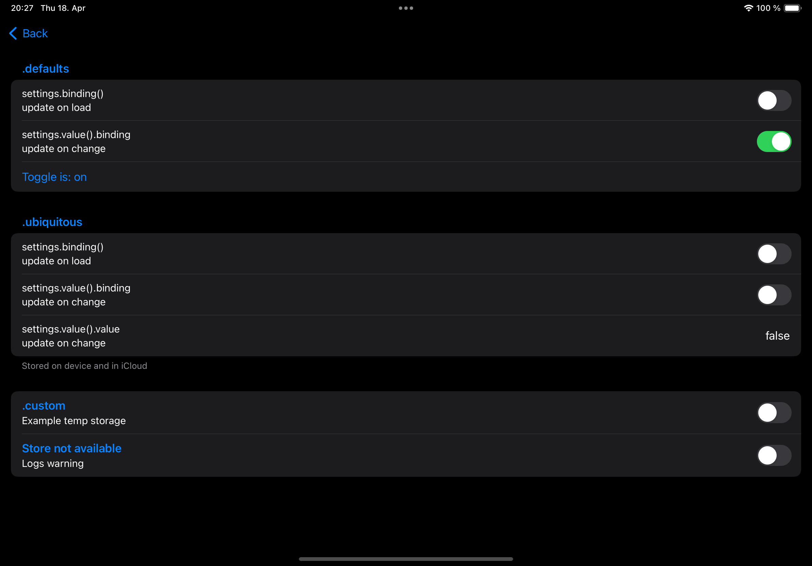

<!-- Copy badges from SPI -->
[](https://swiftpackageindex.com/simonnickel/snap-settings-service)
[](https://swiftpackageindex.com/simonnickel/snap-settings-service) 

> This package is part of the [SNAP](https://github.com/simonnickel/snap) suite.

# SnapSettingsService

A single interface to handle different types of settings. It stores a `Codable` type for a `String` key, either locally (UserDefaults), synced (NSUbiquitousKeyValueStore) or in a custom store.

This package provides the `SettingsService` class, `SettingsStore` protocol and helper to define, save and read settings.

[![Documentation][documentation badge]][documentation] 

[documentation]: https://swiftpackageindex.com/simonnickel/snap-settings-service/main/documentation/snapsettingsservice
[documentation badge]: https://img.shields.io/badge/Documentation-DocC-blue


## Requirements

- iOS 18+, macOS 15+
- Swift 6.3
- Dependencies: [snap-core](https://github.com/simonnickel/snap-core)


## Setup

To support settings stored in iCloud (`NSUbiquitousKeyValueStore`) you have to add the `iCloud` Capability to the target and enable the `Key-value storage` checkbox.


## Demo project

The [demo project](/SnapSettingsServiceDemo) shows an example usage of the SettingsService with settings in different scopes.




## Usage

Define your settings:
```
extension SettingsService.SettingDefinition {
	static let exampleNumber = SettingsService.Setting<Int>("ExampleNumber", in: .defaults, default: 1)
}
```

Read and write the settings:
```
let settings = SettingsService()
settings.set(.exampleNumber, to: 2)
let number = settings.get(.exampleNumber)
```

Use the binding, when you need it to update on changes (`value(_:)` is `@MainActor`):
```
struct MyView: View {
	let observableValue: SettingsService.Value<Int> = settings.value(.exampleNumber)
	var body: some View {
		Text("\(observableValue.value)")
		SomeView(binding: observableValue.binding)
	}
}
```


## Scope

The `SettingsService` can be configured with a `SettingsStore` object for a `Scope`: .defaults, .ubiquitous, .custom(id:)
```
SettingsService.init(defaults: UserDefaults? = .standard, ubiquitous: NSUbiquitousKeyValueStore? = .default, storesForCustomScopes: [Scope : SettingsStore] = [:])
```


### .defaults

Stored locally in `UserDefaults`.

// TODO: How to handle privacy requirements.


### .ubiquitous

Stored in iCloud using `NSUbiquitousKeyValueStore`. 

If iCloud is unavailable, `NSUbiquitousKeyValueStore` stores values locally as a fallback — `SettingsService` is not involved in that fallback. A warning is only logged if no store is registered for the scope at all.

> To use NSUbiquitousKeyValueStore, you must distribute your app through the App Store or Mac App Store, and you must request the com.apple.developer.ubiquity-kvstore-identifier entitlement in your Xcode project.
[NSUbiquitousKeyValueStore Documentation](https://developer.apple.com/documentation/foundation/nsubiquitouskeyvaluestore#)

(see [Setup](#Setup))


### .custom(id:)

You can provide one or multiple custom stores that implement `SettingsStore`.

If there is no store registered for the scope, a warning is logged. 


## SettingsStore

UserDefaults and NSUbiquitousKeyValueStore are extended to conform to SettingsStore.


### Custom

You can create a custom store by implementing `SettingsStore`. 

```
public protocol SettingsStore {
	func get(_ key: SettingsService.StorageKey) -> Data?
	func set(_ key: SettingsService.StorageKey, to data: Data?)
}
```


## Access Setting


### Get & Set

```
let settings = SettingsService()
settings.set(.exampleNumber, to: 2)
let number = settings.get(.exampleNumber)
```

### Observable Value

`value(_:)` is `@MainActor`.

```
struct MyView: View {
	let observableValue: SettingsService.Value<Int> = settings.value(.exampleNumber)
	var body: some View {
		Text("\(observableValue.value)")
		SomeView(binding: observableValue.binding)
	}
}
```

### Publisher

The `SettingsService` provides a Combine publisher to receive updated values. If the setting is stored in the `.ubiquitous` scope, the publisher is updated on remote changes (`NSUbiquitousKeyValueStore.didChangeExternallyNotification`). 


## Environment

The `SettingsService` can be injected via a SwiftUI environment key (`@Entry` on `EnvironmentValues`).

Inject into the `@Environment`:
```
View().environment(\.serviceSettings, settings)
```

Read from `@Environment`:
```
@Environment(\.serviceSettings) private var settings
```


## TODO

// TODO: App Groups? Access in Widget?
// TODO: Handle iCloud not available. It does store locally and logs a warning, but should do something?
// TODO: Compare with https://github.com/kylehughes/PersistentKeyValueKit
// TODO: Compare with https://github.com/sindresorhus/Defaults